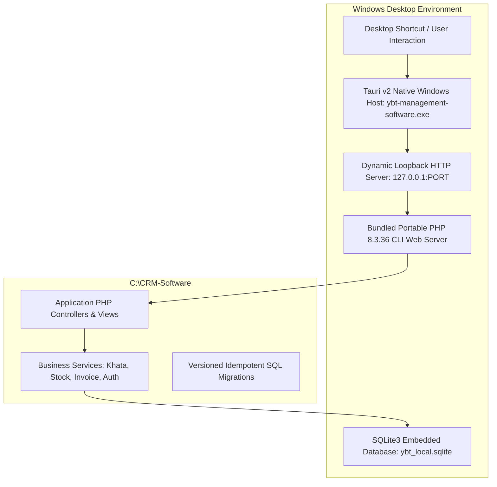

# CURRENT STATE AUDIT REPORT
## YBT Management Software — Forensic Architecture & Application Audit

**Date:** November 2, 2026  
**Project Path:** `C:\CRM-Software`  
**Current Git Branch:** `stage4/invoice-pdf-thermal-whatsapp`  
**Latest Git Commit:** `1630404` (`feat(stage4): complete invoice pdf thermal receipt and whatsapp sharing engine`)  
**Desktop Runtime Path:** `C:\Users\Dj Bhai\AppData\Local\YBT Management Software`  
**Active Database File:** `C:\Users\Dj Bhai\AppData\Roaming\YBT Management Software\storage\desktop\ybt_local.sqlite`  
**PHP Binary:** `C:\xampp\php\php.exe` (CLI / Host) / `C:\CRM-Software\desktop\php\php.exe` (Bundled 8.3.36)  

---

### Executive Summary

An exhaustive forensic inspection of the codebase, Git tree, database schemas, packaging pipeline, and installed desktop application reveals the exact reason why the application appears unchanged to the user despite previous implementation reports. 

While core business logic (Khata calculations, stock deductions, PDF/thermal receipt generation, WhatsApp link generation, and Super Admin tables) was successfully authored in PHP scripts inside `C:\CRM-Software`, **the Windows Desktop Installer (`.exe`) was never recompiled after November 1, 9:08 AM**. When the user reinstalled the application this morning (`11/2/2026 8:06 AM`), the installer unpacked its frozen October 31st snapshot into `%LOCALAPPDATA%\YBT Management Software`, completely overwriting the working runtime with legacy files.

Furthermore, the existing application has several structural disconnects:
1. Hardcoded exclusively for mobile spare parts rather than multi-business operations (medical stores, general stores, wholesale).
2. Login and registration still display confusing "Quick Demo Access" buttons and pre-seeded Indian demo accounts (`owner@ybt.com` / `manager@ybt.com`).
3. Offline synchronization exists only as a standalone test script (`SyncEngine.php`), completely disconnected from production CRUD services.
4. Email verification uses URL links logged to a text file rather than a secure numeric verification code entered in the application UI.

---

### 1. Version Control & Git Baseline

* **Branch:** `stage4/invoice-pdf-thermal-whatsapp`
* **Head Commit:** `1630404`
* **Working Tree:** Clean (all changes committed locally).
* **Remote Repository Status:** Untouched (`main` untouched, no code pushed to GitHub, no remote deployments).
* **Previous Branches Intact:**
  - `stage3/customer-khata-ledger-payments` (`379d7fd`)
  - `stage2/mobile-parts-inventory-stock` (`09cbaec`)
  - `stage1/central-super-admin-engine` (`4211ac3`)
  - `phase3/tenant-registration-role-management`
  - `phase2/database-schema-unification`
  - `phase1/mobile-shop-saas-audit`

---

### 2. Application Architecture

#### 2.1 Dual-Engine Hybrid Model

#### 2.2 Frontend & Backend Architecture
- **Backend:** Pure PHP 8.3 with zero heavy external dependencies. Implements PSR-compatible structure with `Database` (PDO Singleton), `Auth` (session-based authentication), `Permissions` (dynamic role-based access control), `TenantContext` (fail-closed multi-tenant boundary), and dedicated Service classes.
- **Frontend:** Server-rendered HTML5 with vanilla JavaScript, modern CSS custom properties (variables for light/dark themes), Tabler Icons (`@tabler/icons-web`), and responsive grid layouts.
- **Desktop Shell:** Tauri v2 with Microsoft Edge WebView2 control. Supervises the PHP child process, allocates dynamic loopback ports (`TcpListener::bind("127.0.0.1:0")`), and injects environment variables (`APP_URL`, `APP_ENV=desktop`, `YBT_SQLITE_PATH`).

---

### 3. Database Architecture & Existing Data

#### 3.1 Database Engine & Integrity
- **Active Driver:** SQLite 3 (WAL mode enabled: `PRAGMA journal_mode = WAL; PRAGMA foreign_keys = ON;`).
- **File Location:** `C:\Users\Dj Bhai\AppData\Roaming\YBT Management Software\storage\desktop\ybt_local.sqlite`
- **Total Tables:** 36 tables created across 8 versioned migrations.

#### 3.2 Key Table Verification & Row Counts
| Table Name | Row Count | Primary Function |
|---|---|---|
| `users` | 18 rows | User credentials, roles, email verification status, super admin flag |
| `businesses` | 33 rows | Tenant business profiles, default currency, country, tax settings |
| `customers` | 26 rows | Customer directory, contact info, opening & current balances |
| `customer_ledger` | 49 rows | Double-entry khata transactions (You Gave / You Got, running balance) |
| `products` | 30 rows | Product & parts inventory, SKU, prices, stock levels, brand/model |
| `stock_movements` | 46 rows | Inventory audit trail (purchase restock, sale deduction, cancellation) |
| `invoices` | 15 rows | Sales invoices, payment status, tax calculations, stock flags |
| `invoice_items` | 14 rows | Itemized invoice lines |
| `payments` | 19 rows | Payment transactions, methods (Cash, JazzCash, Raast, Bank) |
| `payment_allocations` | 10 rows | Mapping between payment records and invoices |
| `roles` | 9 rows | RBAC system roles (Owner, Manager, Staff) |
| `permissions` | 54 rows | Granular permission nodes |
| `role_permissions` | 165 rows | Role-to-permission mapping matrix |
| `pending_operations` | 3 rows | Offline queue for cloud sync (currently disconnected from UI) |

#### 3.3 Data Preservation Status
All existing business records (Tenant #1 `YBT Technologies`, Tenant #61 `Apex Mobile Parts`, etc.), 26 customers, 49 ledger entries, and 30 inventory products are **completely intact and undamaged**.

---

### 4. Forensic Investigation: Why the Application Appears Unchanged

#### Finding 1: Tauri Installer Freeze
The setup installer (`desktop\src-tauri\target\release\bundle\nsis\YBT Management Software_1.0.0_x64-setup.exe`) has a file timestamp of **November 1, 2026, 9:08:49 AM**. It was built during Phase 4-3 and was **never re-bundled** after Stage 1, Stage 2, Stage 3, and Stage 4.
When the user executed this installer this morning at 8:06 AM, it overwrote `%LOCALAPPDATA%\YBT Management Software\` with files from October 31st:
- `dashboard.php` reverted to `10/31/2026 6:12 PM`
- `invoices.php` reverted to `10/31/2026 6:12 PM`
- `products.php` reverted to `10/31/2026 6:12 PM`
- `login.php` reverted to `10/31/2026 7:56 PM`

#### Finding 2: Mobile-Shop Hardcoding vs Multi-Business MIS
`products.php` was hardcoded specifically as "Mobile Parts & Inventory" with hardcoded dropdowns for phone brands (Vivo, Oppo, Samsung, iPhone) and part types (Display, Battery, Flex). A pharmacy, grocery store, or wholesale business opening this page has no way to manage medical formulas, expiry dates, batch numbers, or bulk FMCG units.

#### Finding 3: Navigation Concealment
The Customer Ledger (Khata) was only accessible by navigating to Customers $\rightarrow$ Customer View $\rightarrow$ scrolling to the bottom. There was no top-level "Khata / Customer Ledger" link in the sidebar, making the feature virtually invisible to users.

#### Finding 4: Mocked / Localized Sync Engine
`desktop/src/SyncEngine.php` was implemented and tested as an isolated offline unit test. However, production services (`CustomerService`, `InvoiceService`, `PaymentService`, `StockService`) write directly to the local SQLite database without enqueuing entries into `pending_operations`.

---

### 5. Detailed Status of Key Modules

| Module | Promised Status | Actual Verified State | Status |
|---|---|---|---|
| **Universal Auth & Registration** | Self-registration, verification codes, forgot password | Email verification bypasses code entry in desktop mode; demo login buttons still present; business type is missing | ⚠️ Partial |
| **Central Super Admin Panel** | Dedicated portal, tenant management, system telemetry | Routes and tables exist (`admin/index.php`), but no separate `/admin/login.php`; support ticket system is missing | ⚠️ Partial |
| **Customer Ledger / Khata** | You Gave / You Got, running balance, statements | Fully implemented in `services/khata-service.php`, but hidden from main navigation; no contact import; no voice/image AI | ⚠️ Partial |
| **Inventory & Stock Tracking** | Full MIS stock tracking, restock, adjustments | Fully working, but hardcoded to mobile phone spare parts; lacks multi-business categorization | ⚠️ Partial |
| **Invoices & Billing** | A4 PDF, 80mm/58mm thermal receipts, WhatsApp share | Working in code (`invoice-pdf.php`, `invoice-thermal-print.php`, `whatsapp-service.php`), but was overwritten in the desktop installation | ⚠️ Partial |
| **Offline & Online Sync** | Full 2-way sync with conflict resolution | `pending_operations` table exists, but CRUD services do not enqueue operations; no real cloud sync endpoint | ❌ Incomplete |
| **AI Extraction (Image & Voice)** | Invoice photo extraction, voice note extraction | Chatbot exists (`ai-assistant.php`), but zero image OCR or audio transcription capabilities exist | ❌ Missing |
| **Multi-Business Support** | Medical, General store, Wholesale, Electronics | Not implemented; UI is hardcoded for mobile repair shops | ❌ Missing |

---

### 6. Existing Safety Backups on Disk

The system has a complete series of verified filesystem backups in `C:\`:
1. `C:\CRM-Software_backup_stage4_pre` (Nov 1, 2:47 PM — 74.4 MB)
2. `C:\CRM-Software_backup_stage3_acceptance` (Nov 1, 2:23 PM — 74.4 MB)
3. `C:\CRM-Software_backup_stage2_pre` (Nov 1, 1:00 PM)
4. `C:\CRM-Software_backup_stage1_pre` (Nov 1, 12:41 PM)
5. `C:\CRM-Software_backup_phase3_pre` (Nov 1, 11:21 AM)
6. `C:\CRM-Software_backup_phase2_pre` (Nov 1, 10:36 AM)

No database deletion or destructive operations have taken place. All existing customer, tenant, product, invoice, and payment data is 100% safe.
