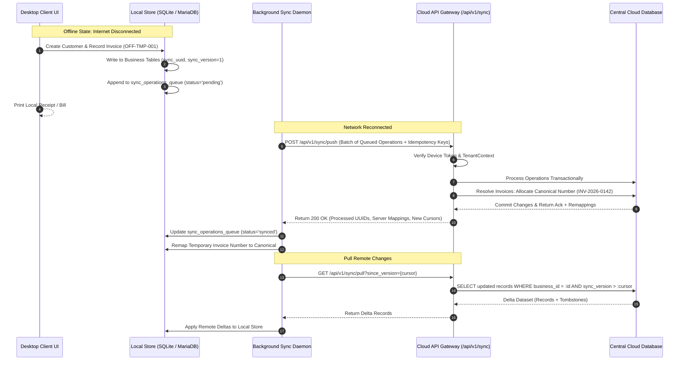
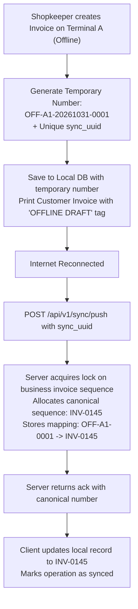

# Offline-First Data Synchronization Architecture & Conflict Engine

## 1. Architectural Philosophy

In retail and mobile repair environments, network connectivity is volatile. A commercial POS cannot halt transactions due to intermittent internet outages or ISP degradation.

The synchronization engine follows these fundamental tenets:
1. **Local-First Writes:** All operational records (customers, invoices, payments, repairs, expenses) are written directly to local storage first, ensuring zero UI latency.
2. **Transaction-Aware Replication:** Financial ledgers, invoices, and payments are **never** subjected to arbitrary "Last-Write-Wins" (LWW) conflict resolution. Financial entries are strictly append-only or reconciled via server-authoritative sequential assignment.
3. **Idempotency Guarantee:** Network retries, dropped connections, and duplicate packets must never produce duplicate invoices or double-counted payments.
4. **Tombstone-Based Deletion:** Soft deletes (`is_deleted = 1` or `sync_tombstones`) propagate deletions across distributed devices without orphan records.

---

## 2. Synchronization Architecture & Data Flow



---

## 3. Data Structures for Offline Synchronization

### 3.1 Synchronizable Entity Standard Columns
Every synchronizable table (`customers`, `products`, `invoices`, `payments`, `expenses`, `leads`, `tasks`) contains the following metadata columns:

| Column | Type | Purpose |
| :--- | :--- | :--- |
| `sync_uuid` | `CHAR(36)` | Globally unique identifier (UUIDv4) generated at the creation site. |
| `sync_version` | `BIGINT UNSIGNED` | Monotonically increasing version counter incremented on each mutation. |
| `client_updated_at` | `TIMESTAMP` | Client-reported timestamp of the edit event. |
| `is_deleted` | `TINYINT(1)` | Soft-delete flag (0 = active, 1 = deleted/tombstone). |

### 3.2 Synchronization Queue Table (`sync_operations_queue`)
Maintained on the client (and mirrored in the cloud for replay logs):
```sql
CREATE TABLE `sync_operations_queue` (
  `id` BIGINT UNSIGNED AUTO_INCREMENT PRIMARY KEY,
  `operation_uuid` CHAR(36) NOT NULL UNIQUE,
  `business_id` INT UNSIGNED NOT NULL,
  `device_id` VARCHAR(100) NOT NULL,
  `entity_type` VARCHAR(50) NOT NULL,
  `entity_uuid` CHAR(36) NOT NULL,
  `operation_type` ENUM('insert', 'update', 'delete') NOT NULL,
  `payload` LONGTEXT NOT NULL,
  `client_timestamp` TIMESTAMP NOT NULL,
  `status` ENUM('pending', 'in_flight', 'synced', 'conflict', 'failed') DEFAULT 'pending',
  `retry_count` INT UNSIGNED DEFAULT 0,
  `error_message` TEXT DEFAULT NULL,
  `created_at` TIMESTAMP DEFAULT CURRENT_TIMESTAMP,
  INDEX `idx_sync_queue_status` (`business_id`, `status`),
  INDEX `idx_sync_queue_entity` (`entity_type`, `entity_uuid`)
) ENGINE=InnoDB;
```

### 3.3 Tombstone Table (`sync_tombstones`)
Records explicit record expulsions to ensure deletions are replicated across all devices:
```sql
CREATE TABLE `sync_tombstones` (
  `id` BIGINT UNSIGNED AUTO_INCREMENT PRIMARY KEY,
  `business_id` INT UNSIGNED NOT NULL,
  `entity_type` VARCHAR(50) NOT NULL,
  `entity_uuid` CHAR(36) NOT NULL,
  `deleted_by` INT UNSIGNED DEFAULT NULL,
  `deleted_at` TIMESTAMP DEFAULT CURRENT_TIMESTAMP,
  UNIQUE KEY `uk_tombstone_entity` (`business_id`, `entity_type`, `entity_uuid`),
  INDEX `idx_tombstone_date` (`business_id`, `deleted_at`)
) ENGINE=InnoDB;
```

---

## 4. Category-Specific Conflict Policies

| Data Domain | Synchronization Nature | Conflict Policy | Technical Mechanism |
| :--- | :--- | :--- | :--- |
| **Invoices & Billing** | Server-Authoritative / Append-Only | **No Last-Write-Wins.** Server allocates final invoice sequence. | Client uses `OFF-TMP-{device_id}-{local_id}` while offline. Upon push, server allocates official sequence (`INV-0042`) and returns ID mapping. Existing invoices cannot be overwritten silently. |
| **Payments** | Strictly Append-Only | **Additive Only.** | Payments are immutable transaction entries. If a payment is recorded offline, it is appended to customer balance and allocated to invoices upon cloud reconciliation. |
| **Customer Profile** | Mutable Profile | **Field-Level 3-Way Merge or Highest Version.** | If Name was edited on Device A and Phone on Device B, both fields are merged. If the same field was edited, highest `sync_version` / latest timestamp wins with change logged. |
| **Products & Inventory**| Mutable Catalog & Transactional Stock | **Delta Stock Adjustment.** | Catalog details use Version LWW. Stock count is never overwritten as an absolute value; instead, stock changes are applied as relative increments/decrements (`+5` or `-1`). |
| **Expenses** | Append-Only | **Additive Only.** | Every recorded expense receives a distinct `sync_uuid`. Duplicates are caught by idempotency hash. |
| **Deletions** | Tombstone Propagation | **Tombstone Priority.** | A tombstone wins over an update unless the update occurred at a strictly later timestamp with an explicit un-delete flag. |

---

## 5. Offline Invoice Numbering Guarantee

To prevent numbering gaps or duplicate invoice numbers across concurrent disconnected devices:



---

## 6. Fault Tolerance & Recovery Protocols

1. **Crash During Sync:** If the application crashes or loses power while a sync operation is `in_flight`, the queue entry remains in `in_flight` with a timeout. Upon application startup, all `in_flight` operations older than 5 minutes are reset to `pending` and re-submitted with their existing `operation_uuid`.
2. **Server Idempotency:** The cloud server checks `api_idempotency_keys` before executing any sync operation. If an operation was already committed before the crash, the server returns the cached response without re-executing.
3. **Backoff & Rate Limiting:** Sync retries use exponential backoff with jitter: $T_{retry} = \min(300, 2^{attempt} \times 2) \pm \text{jitter}$ seconds.
