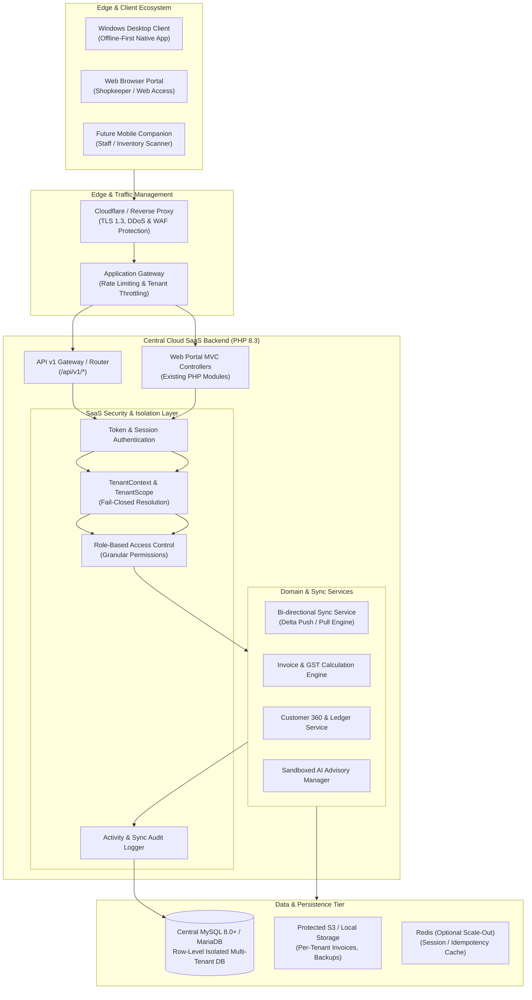
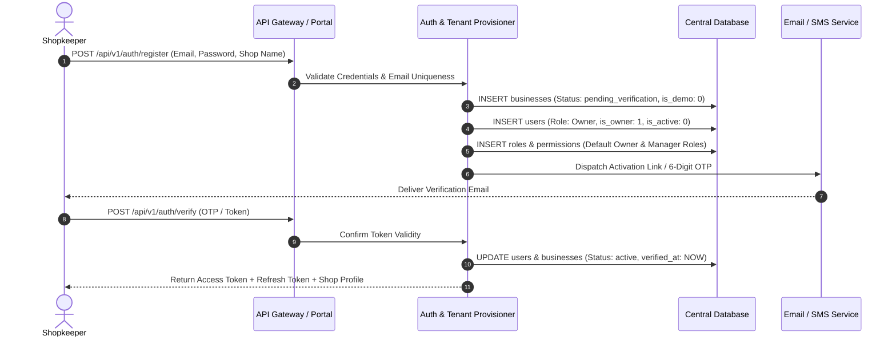

# YBT Management Software — Enterprise SaaS Architecture

## 1. Executive Summary

This document specifies the Enterprise SaaS Architecture for transforming **YBT Management Software** into a multi-tenant, cloud-orchestrated, offline-first commercial platform for retail businesses, mobile retail shops, and mobile repair enterprises.

The architecture preserves the existing PHP 8.3 native backend, MySQL schema, and UI workflows while layering:
1. **Server-Enforced Multi-Tenancy (Fail-Closed Tenant Isolation)**
2. **Stateless API v1 with Cryptographic Bearer Tokens & Refresh Token Rotation**
3. **Offline-First Synchronization Engine (Bi-directional Delta Replication)**
4. **Desktop Native Client Strategy (Tauri / Electron Hybrid)**
5. **Zero-Trust Audit, Disaster Recovery & Per-Tenant Encryption**

---

## 2. High-Level System Architecture

---

## 3. Multi-Tenant Architecture Principles

### 3.1 Logical Row-Level Isolation with Cryptographic Separation
- **Tenant Key:** Every tenant is identified by a unique `business_id` (BIGINT UNSIGNED) and a globally unique `tenant_uuid` (UUIDv4).
- **Strict Query Scoping:** Every SQL statement touching tenant data is wrapped in a strict tenancy filter (`WHERE business_id = :tenant_id`). Unscoped queries are rejected at runtime.
- **Fail-Closed Guarantee:** If an incoming request does not resolve to an active, authenticated, and verified tenant, the application aborts immediately with HTTP 401/403. No database connection is permitted to run untracked SQL.
- **Client Input Disregard:** `business_id` supplied in request payloads (GET, POST, JSON) is strictly ignored. The server derives `business_id` exclusively from cryptographically verified authentication credentials (Server-Side Session or HMAC-verified Bearer Token).

### 3.2 Tenant Lifecycle & Provisioning

---

## 4. Desktop Client to Cloud Interaction

The Windows Desktop application operates in two distinct network states:

1. **Online State:**
   - Real-time synchronization of local mutations via `/api/v1/sync/push`.
   - Periodic incremental fetch of cloud changes via `/api/v1/sync/pull?since_cursor={version}`.
   - Remote queries for AI advisory and global reports.
2. **Offline State:**
   - Full read/write access to the local database for daily POS, repair ticketing, invoice generation, customer billing, and expense recording.
   - Local mutations are appended to the local `sync_operations_queue` with idempotency UUIDs.
   - Offline invoices receive a collision-resistant temporary number (e.g., `OFF-TMP-{device_id}-{counter}`) until online reconciliation allocates the sequential invoice number.

---

## 5. Security & Boundary Enforcement Matrix

| Boundary | Mechanism | Failure Mode |
| :--- | :--- | :--- |
| **Authentication** | Bearer Token (access: 60m, refresh: 30d with rotation) / Session Cookie (SameSite=Lax, HttpOnly, Secure) | HTTP 401 Unauthorized |
| **Tenant Isolation** | Server-side `TenantContext::id()` injected into all queries | HTTP 403 Forbidden / Runtime TenancyException |
| **Role-Based Access** | `Permissions::require('perm.key')` checked against authenticated user | HTTP 403 Forbidden |
| **Data at Rest** | Sensitive fields encrypted via AES-256-GCM with tenant-derived keys | Decryption failure logged; access denied |
| **API Idempotency** | `X-Idempotency-Key` header cached in `api_idempotency_keys` | Replay cached response; avoid duplicate mutation |
| **Disaster Recovery** | Per-tenant SQL exports validated for schema and tenant ownership | Refuse restore if cross-tenant data detected |

---

## 6. Observability and Audit Logging
- Every state change triggers an entry in `activity_logs` containing `business_id`, `user_id`, `device_id`, `action`, `entity_type`, `entity_id`, and `ip_address`.
- Failed authentication, cross-tenant access attempts, and invalid token presentations trigger immediate security telemetry entries with IP throttling.
